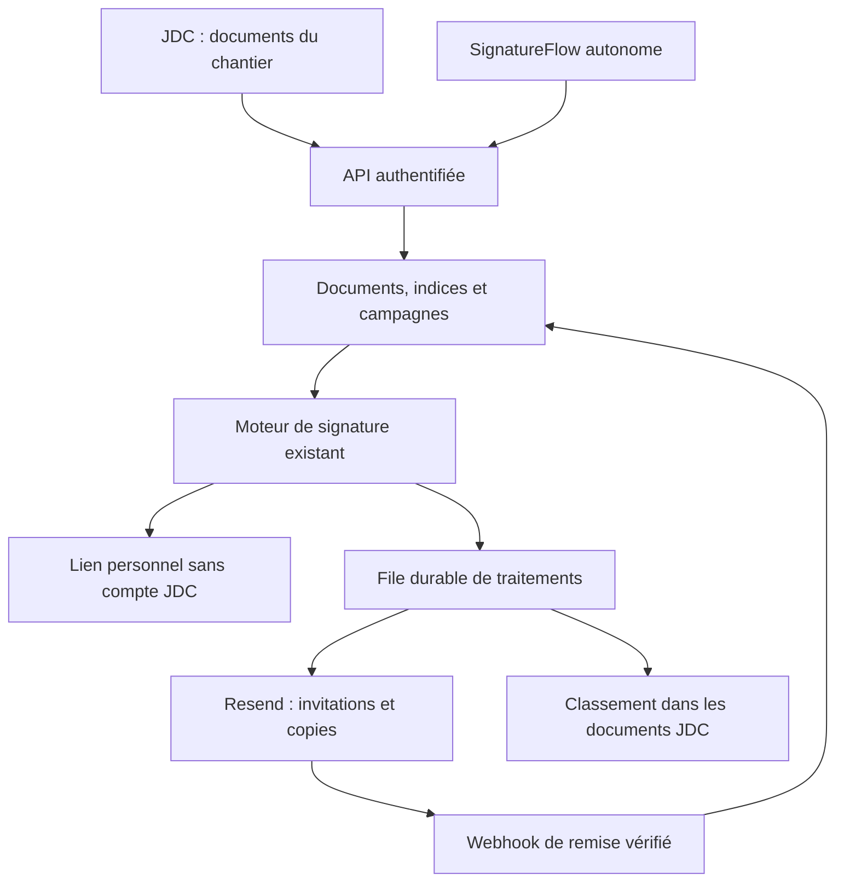

# SignatureFlow 3 — indépendant et intégré à Journal de chantier

Livraison préparée le 20 novembre 2026. Cette archive contient le code et les scripts ; son téléchargement n’active aucun envoi réel et ne modifie pas la version publiée.

## Deux usages conservés

1. **SignatureFlow autonome** : l’organisateur ouvre son espace, prépare des PDF et diffuse des liens. La nouvelle page `document-flow.html` gère les documents, indices et campagnes indépendants d’un chantier JDC. L’ancien circuit reste disponible.
2. **Journal de chantier** : Documents de chantier > Signatures et prises de connaissance. Les droits et la connexion JDC sont réutilisés pour le suivi et les prises de connaissance. Un PDF déjà classé possède une action Faire signer / suivre.
3. **Destinataire extérieur** : e-mail personnel > lecture du PDF > signature > copie par e-mail. Aucun compte JDC ni installation n’est demandé. Le moteur public de signature existant est conservé.

L’espace organisateur autonome nécessite un compte Supabase autorisé. Un compte organisateur n’impose pas d’appartenance à un chantier. Les destinataires n’ont pas besoin de ce compte. La création publique de comptes n’est pas activée par cette mise à jour.

## Circuits documentaires

| Document | Signature d’application | Prise de connaissance |
|---|---|---|
| CSF | Rédacteur seul | Responsables et interlocuteurs, dans l’annexe |
| ISF | Entreprises concernées, emplacements dans le PDF | Intervenants, RSO et autres fonctions, dans l’annexe |
| PPSPS | Circuit défini par l’organisateur | Destinataires sélectionnés |
| Particularités locales | Au besoin | Ensemble des agents concernés, dans l’annexe |
| Autre | Paramétrable | Paramétrable |

Une CSF déjà signée peut être importée directement pour prise de connaissance. Le PDF original est conservé octet pour octet. Une copie assemblée reçoit les annexes ; elle ne remplace pas l’original et ne préserve pas nécessairement la validité cryptographique d’une signature numérique déjà contenue dans celui-ci.

Les campagnes d’application sont terminées avant d’ouvrir celles de prise de connaissance. Pour les signatures placées dans le corps du PDF, le bouton de contrôle ouvre l’éditeur SignatureFlow existant ; l’organisateur s’y connecte si sa session autonome n’est pas déjà ouverte. Pour les annexes, les emplacements sont générés et la validation peut se faire directement dans JDC.

## Documents, indices et nouveaux arrivants

Un document possède un identifiant propre et des versions immuables : titre, type, indice, motif, date d’application, original et empreinte SHA-256. Le chantier et le dossier sont reliés par identifiant, jamais par rapprochement de noms.

La publication d’un nouvel indice annule les demandes non terminées de l’ancien. Les signatures, originaux, événements et archives précédents sont conservés. Une signature en cours d’enregistrement bloque momentanément le remplacement pour éviter toute perte.

Une ISF peut référencer la CSF courante. Une évolution de cette CSF produit une alerte dans le suivi ISF et bloque les nouvelles diffusions de cet ancien indice ISF jusqu’à sa révision. Cela n’invente pas automatiquement une nouvelle ISF.

Un nouvel arrivant fait l’objet d’une nouvelle campagne sur le même indice. Les intervenants déjà signataires ne sont pas obligés de recommencer. Les campagnes sont regroupées dans les états documentaires. Une collecte complète est un état à une date donnée ; l’ajout de nouveaux destinataires ouvre un nouveau suivi.

## Notifications et mails

JDC affiche un bouton de demandes en attente et un avis non bloquant. L’avis ne prend pas le focus pendant une saisie ; la liste reste accessible. La vérification se fait en ligne, à l’ouverture puis toutes les 30 secondes lorsque l’application est visible. Il s’agit d’une notification dans l’application ouverte ; aucune notification Android en arrière-plan n’est ajoutée.

Le suivi distingue : invitation en attente, acceptée par Resend, remise au serveur destinataire, document ouvert, signature enregistrée. La remise d’un e-mail ou l’ouverture d’un PDF n’est pas présentée comme une signature.

Après chaque signature, une tâche durable prépare la copie personnelle et le classement. Après la collecte complète, le dossier est envoyé aux participants et personnes en copie. Les PDF intermédiaires et finaux sont classés dans le dossier JDC choisi, avec un nom indiquant l’indice et le nombre de signatures. Une panne de mail ne défait pas la signature. Les traitements sont repris automatiquement et peuvent être relancés depuis le suivi.

Les liens personnels sont stockés chiffrés côté serveur. L’accès natif à une invitation correspond exactement à l’adresse e-mail vérifiée du compte connecté. Les responsables extérieurs utilisent le lien reçu sans compte.

## Architecture

Les tables `sf3_*` et leurs fonctions sont accessibles uniquement au serveur. Les droits JDC sont évalués avec le JWT de l’utilisateur, pas avec le compte de service. Les opérations de génération de liens et de mise en file sont transactionnelles. Le classement compare un instantané verrouillé afin de ne pas annoncer un PDF complet sur un état périmé.

## Limites d’exploitation

PDF original de 20 Mo et 190 pages maximum pour ce nouveau circuit, afin de réserver les annexes. Le circuit historique conserve ses limites. Un dossier de signature regroupe au plus 40 personnes ; les prises de connaissance sont découpées automatiquement en dossiers. La validation des destinataires accepte jusqu’à 1 000 personnes, mais privilégier plusieurs campagnes raisonnables pour les PDF lourds et les réseaux mobiles. Un grand lot de documents n’a pas fait l’objet d’un essai de charge en production.

Les documents et signatures sont enregistrés en ligne. Les signatures ne sont pas validées hors connexion. Le module constate une lecture déclarée et un consentement ; les responsabilités opérationnelles restent gérées dans l’organisation du chantier.
